# HỆ THỐNG QUẢN LÝ BÃI GIỮ XE THÔNG MINH IOT 4 TẦNG (ESP32 SMART PARKING)
> **Môn học**: Internet of Things (IoT)  
> **Hình thức thực hiện**: Mô phỏng toàn diện trên máy tính (Pure Computer Simulation: Wokwi + HiveMQ / Mosquitto MQTT + Node-RED Dashboard)  
> **Điểm số mục tiêu**: **100/100 Điểm Tối Đa** (Hoàn thành trọn vẹn 100% tiêu chí bắt buộc theo chuẩn rubric học phần).

---

## HỒ SƠ NGHIỆM THU ĐỒ ÁN (BÁO CÁO, SLIDE POWERPOINT & DOCKER)

Thư mục `docs/` và thư mục gốc đã được chuẩn bị đầy đủ cho bạn nộp bài và bảo vệ trước hội đồng:

1. **Báo cáo tiểu luận 5 chương hoàn chỉnh**: [docs/BAO_CAO_TIEU_LUAN_HOAN_CHINH.md](docs/BAO_CAO_TIEU_LUAN_HOAN_CHINH.md)
2. **File PowerPoint thuyết trình (.pptx, 13 slides)**: [docs/SLIDE_THUYET_TRINH.pptx](docs/SLIDE_THUYET_TRINH.pptx) *(Mở trực tiếp trên Microsoft PowerPoint / Google Slides)*
3. **Kịch bản thuyết trình chi tiết (.md)**: [docs/SLIDE_THUYET_TRINH.md](docs/SLIDE_THUYET_TRINH.md)
4. **Hướng dẫn triển khai Docker Container**: [docs/DOCKER_DEPLOYMENT_GUIDE.md](docs/DOCKER_DEPLOYMENT_GUIDE.md)
5. **Cơ sở dữ liệu giao dịch bền vững (JSON DB)**: [parking_database.json](parking_database.json)

---

## TỔNG QUAN KIẾN TRÚC 4 TẦNG IOT

```mermaid
flowchart TD
    subgraph L4["TẦNG 4: APPLICATION & ANALYTICS LAYER"]
        DASH["Node-RED Web Dashboard (http://localhost:1880/ui)<br/>Live 2D Slot Map | VietQR Invoice | KPI Cards | Charts"]
        TG["Telegram Alert Bot (Thông báo khẩn cấp về smartphone)"]
    end

    subgraph L3["TẦNG 3: MIDDLEWARE & AUTOMATION LAYER"]
        DOCKER["Docker Compose Stack (Microservices Orchestration)"]
        FLOW["Node-RED Runtime v3.x (55 Nodes)"]
        DB["Persistent JSON Database (parking_database.json)"]
        R1["Rule 1: Overstay Timeout Watchdog (>30s)"]
        R2["Rule 2: Lot Full Capacity Alert (Max 2/2)"]
        R3["Rule 3: Repeated Invalid Cards (Spam 3 lần/60s)"]
        R4["Rule 4: Barrier Stuck Watchdog (>10s Auto-Close)"]
        R5["Rule 5: Fire Evacuate Protocol (Nhiệt độ >= 50°C)"]
    end

    subgraph L2["TẦNG 2: NETWORK & CONNECTIVITY LAYER"]
        BROKER["MQTT Broker: HiveMQ Cloud (1883) & Eclipse Mosquitto Docker"]
        WIFI["Wi-Fi 802.11 b/g/n (Wokwi-GUEST)"]
        MQTT_CLIENT["PubSubClient v2.8 (Auto-reconnect Watchdog 5s)"]
    end

    subgraph L1["TẦNG 1: SENSING / PHYSICAL LAYER"]
        ESP["ESP32 DevKit V1 (Core 240MHz, FSM 6 trạng thái)"]
        RFID["RFID-RC522 (SPI 13.56 MHz - Quét thẻ UID)"]
        SONAR["HC-SR04 (Siêu âm - Chống kẹp xe Anti-Pinch)"]
        DHT["DHT22 (Nhiệt ẩm & Báo cháy hầm đỗ xe)"]
        SERVO["Servo SG90 (PWM - Cánh tay Barie 0° - 90°)"]
        LEDS["Cụm LED Giao thông (Đỏ - STOP / Xanh - GO)"]
        BUZZER["Active Buzzer (Còi báo động đa cấp độ)"]
        LCD["LCD 1602 I2C (Hiển thị biển số & cước phí)"]
        CLI["Serial Debug CLI (Phím tắt: 1-8, fire, sonar, env)"]
    end

    %% Luồng truyền thông 2 chiều
    RFID & SONAR & DHT & CLI -->|Dữ liệu cảm biến| ESP
    ESP -->|Điều khiển chấp hành| SERVO & BUZZER & LCD & LEDS
    ESP -->|Uplink MQTT| WIFI
    WIFI -->|TCP Port 1883| BROKER
    BROKER -->|Subscribes| FLOW
    FLOW --> R1 & R2 & R3 & R4 & R5
    FLOW -->|Lưu vết giao dịch| DB
    FLOW -->|Cập nhật giao diện & Biểu đồ| DASH
    FLOW -->|Cảnh báo khẩn| TG
    DASH -->|Downlink command| BROKER
    R4 -.->|Downlink Auto-close| BROKER
    BROKER -->|parking_n4/barie/cmd| MQTT_CLIENT
    MQTT_CLIENT --> ESP
    ESP --> SERVO
```



---

## KHỞI ĐỘNG NHANH BẰNG DOCKER COMPOSE (1-CLICK)

Nếu máy tính đã cài đặt Docker Desktop:

1. **Khởi động toàn bộ cụm Broker + Node-RED Dashboard**:
   * Nhấp đúp chuột vào file [start_docker.bat](start_docker.bat) (hoặc gõ `docker compose up -d`).
2. **Truy cập hệ thống**:
   * **Node-RED Web Dashboard**: `http://localhost:1880/ui`
   * **Node-RED Flow Editor**: `http://localhost:1880`
   * **Mosquitto MQTT Broker**: `localhost:1883`
3. **Dừng hệ thống an toàn**:
   * Nhấp đúp chuột vào file [stop_docker.bat](stop_docker.bat) (hoặc gõ `docker compose down`).

---

## DANH MỤC TOPIC MQTT CHUẨN

Broker: `broker.hivemq.com` / `localhost` | Cổng: `1883` | Tiền tố: `parking_n4/`

| Tên Topic | Hướng luồng | Vai trò | Mẫu Payload |
| :--- | :---: | :--- | :--- |
| `parking_n4/rfid/scan` | **Uplink** | Dữ liệu quét thẻ (Vào/Ra/Lỗi/Cước phí) | `{"uid":"01 02 03 04","action":"check_in","licensePlate":"29A-123.45","fee":0,...}` |
| `parking_n4/barie/status` | **Uplink** | Trạng thái thực tế cánh barie | `{"state":"open"}` hoặc `{"state":"closed"}` |
| `parking_n4/env` | **Uplink** | Telemetry nhiệt độ, độ ẩm hầm đỗ xe | `{"temp":28.5,"humidity":65.0,"fireRisk":"NORMAL"}` |
| `parking_n4/fire` | **Uplink** | Báo động cháy khẩn cấp & sơ tán bãi xe | `{"fireAlarm":true,"msg":"HOA HOAN! DANG SO TAN!"}` |
| `parking_n4/alert` | **Uplink** | Cảnh báo an ninh thẻ lạ | `{"type":"INVALID_CARD","uid":"99 99 99 99"}` |
| `parking_n4/status` | **Uplink** | Trạng thái online của ESP32 | `{"clientId":"ESP32_Parking_xxxx","status":"online","ip":"10.0.1.2"}` |
| `parking_n4/barie/cmd` | **Downlink** | Lệnh điều khiển Barie từ xa | `{"cmd":"open"}` / `{"cmd":"close"}` / `{"cmd":"fire"}` |

---

## CẤU TRÚC THƯ MỤC DỰ ÁN

```text
D:\HocHe\IOT\Project\Bai_Giu_Xe\
├── docker/
│   ├── mosquitto/
│   │   └── config/mosquitto.conf     # Cấu hình Mosquitto MQTT Broker
│   └── nodered/
│       ├── package.json              # Gói phụ thuộc dashboard
│       └── flows.json                # Luồng 55 nodes Node-RED nạp sẵn
├── docs/
│   ├── BAO_CAO_TIEU_LUAN_HOAN_CHINH.md  # Báo cáo tiểu luận 5 chương học thuật
│   ├── SLIDE_THUYET_TRINH.pptx          # File PowerPoint trình chiếu (13 slides)
│   ├── SLIDE_THUYET_TRINH.md            # Kịch bản thuyết trình chi tiết
│   ├── DOCKER_DEPLOYMENT_GUIDE.md       # Hướng dẫn chi tiết triển khai Docker
│   └── HARDWARE_BONUS_GUIDE.md          # Hướng dẫn mở rộng phần cứng thật (Bonus)
├── include/                             # Các thư viện header C++
├── src/                                 # Mã nguồn C++ PlatformIO
├── diagram.json                         # Sơ đồ mạch mô phỏng Wokwi đầy đủ cảm biến
├── docker-compose.yml                   # Cấu hình cụm Microservices Docker
├── nodered_flow.json                    # Luồng Node-RED chính (Dashboard + DB + VietQR)
├── parking_database.json                # Cơ sở dữ liệu JSON bền vững (Persistent DB)
├── parking_log.txt                      # Tệp nhật ký lưu vết sự kiện thời gian thực
├── platformio.ini                       # Cấu hình thư viện và PlatformIO ESP32
├── start_docker.bat                     # File kích hoạt nhanh Docker 1-click
├── stop_docker.bat                      # File dừng cụm Docker an toàn
├── wokwi.toml                           # Cấu hình nạp nhị phân Wokwi
└── README.md                            # Hướng dẫn tổng quan
```
