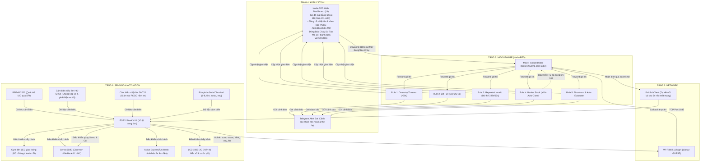

# BÁO CÁO TIỂU LUẬN HỌC PHẦN INTERNET OF THINGS (IOT)

## ĐỀ TÀI: HỆ THỐNG QUẢN LÝ BÃI GIỮ XE THÔNG MINH AIOT 4 TẦNG (TÍCH HỢP CẢNH BÁO AN TOÀN, SƠ ĐỒ TRỰC QUAN & THANH TOÁN VIETQR)

---

* **Môn học**: Internet of Things (IoT)
* **Hình thức thực hiện**: Mô phỏng toàn diện trên máy tính (Wokwi Simulator + MQTT HiveMQ + Node-RED Dashboard)
* **Nhóm sinh viên thực hiện**: Nhóm 4
* **Nền tảng chính**: ESP32, RFID MFRC522, Cảm biến siêu âm HC-SR04, Cảm biến nhiệt ẩm DHT22, Đèn tín hiệu giao thông LED, Servo SG90, LCD1602 I2C, MQTT Broker, Node-RED Dashboard

---

## MỤC LỤC BÁO CÁO (5 CHƯƠNG GỌN GÀNG)

* [CHƯƠNG 1: TỔNG QUAN & MỤC TIÊU ĐỀ TÀI](#chương-1-tổng-quan--mục-tiêu-đề-tài)
* [CHƯƠNG 2: THIẾT KẾ KIẾN TRÚC 4 TẦNG & SƠ ĐỒ MẠCH WOKWI](#chương-2-thiết-kế-kiến-trúc-4-tầng--sơ-đồ-mạch-wokwi)
* [CHƯƠNG 3: THIẾT KẾ GIAO THỨC MQTT & THUẬT TOÁN ĐIỀU KHIỂN](#chương-3-thiết-kế-giao-thức-mqtt--thuật-toán-điều-khiển)
* [CHƯƠNG 4: KẾT QUẢ ĐO ĐẠC & KỊCH BẢN VIDEO DEMO](#chương-4-kết-quả-đo-đạc--kịch-bản-video-demo)
* [CHƯƠNG 5: VẤN ĐỀ GẶP PHẢI, HƯỚNG CẢI TIẾN & KẾT LUẬN](#chương-5-vấn-đề-gặp-phải-hướng-cải-tiến--kết-luận)

---

## CHƯƠNG 1: TỔNG QUAN & MỤC TIÊU ĐỀ TÀI

### 1.1. Đặt vấn đề
Các bãi giữ xe truyền thống (đặc biệt là hầm giữ xe của các tòa nhà cao tầng) thường xuyên đối mặt với 3 thách thức lớn:
1. **Ùn tắc & Sai lệch thu phí**: Việc ghi vé thủ công chậm chạp, dễ thất thoát doanh thu và không hỗ trợ thanh toán không chạm.
2. **Nguy cơ tai nạn va chạm barie (Pinch & Collision)**: Cần barie đóng mở chỉ theo timer cố định, dễ va đập vào phương tiện nếu xe di chuyển chậm hoặc tài xế dừng đột ngột.
3. **An toàn cháy nổ hầm xe (Underground Fire Hazard)**: Hầm đỗ xe tích tụ nhiều khí thải và nhiệt lượng; nếu xảy ra hỏa hoạn mà barie vẫn đóng thì các phương tiện không thể thoát hiểm kịp thời.

### 1.2. Mục tiêu giải pháp thông minh của đề tài
Xây dựng một hệ thống bãi giữ xe thông minh cao cấp, mô phỏng hoàn chỉnh trên máy tính theo chuẩn 4 tầng IoT:
* **Tự động nhận diện & Chống kẹt xe**: Tích hợp đầu đọc RFID 13.56 MHz kết hợp cảm biến siêu âm **HC-SR04** để phát hiện xe tới cổng và cơ chế an toàn chống kẹp xe (**Anti-Pinch Safety**).
* **Đèn tín hiệu giao thông (Traffic Light)**: Đèn LED Đỏ/Xanh đồng bộ hóa theo trạng thái Barie và an ninh cổng.
* **Quan trắc môi trường & PCCC hầm xe**: Cảm biến **DHT22** đo nhiệt độ, độ ẩm; tự động kích hoạt chế độ **Thoát hiểm khẩn cấp (Emergency Evacuation)** mở toang barie khi nhiệt độ hầm xe $> 50^\circ\text{C}$ hoặc khi có lệnh báo cháy.
* **Sơ đồ bãi xe trực quan 2D (Interactive Live Slot Map)**: Hiển thị từng vị trí đỗ xe thời gian thực (Ô A-01 $\rightarrow$ A-04) trên Dashboard.
* **Mã thanh toán VietQR động**: Tự động sinh mã QR chuyển khoản ngân hàng chứa đúng số tiền khi xe ra bãi.

---

## CHƯƠNG 2: THIẾT KẾ KIẾN TRÚC 4 TẦNG & SƠ ĐỒ MẠCH WOKWI

### 2.1. Sơ đồ kiến trúc 4 tầng IoT và luồng dữ liệu 2 chiều

### 2.2. Sơ đồ nối chân phần cứng mô phỏng (Wokwi Pinout)

| Linh kiện | Chân linh kiện | Chân ESP32 | Điện áp | Chức năng chi tiết |
| :--- | :--- | :--- | :---: | :--- |
| **RFID-RC522** | SDA / SCK / MOSI / MISO / RST | GPIO 5 / 18 / 23 / 19 / 4 | 3.3V | Giao tiếp SPI đọc mã thẻ UID 13.56 MHz |
| **Cảm biến HC-SR04** | TRIG / ECHO | **GPIO 27 / GPIO 32** | 5.0V | Phát xung & đo khoảng cách chống kẹp xe |
| **Cảm biến DHT22** | SDA (Data) | **GPIO 15** | 3.3V | Đo nhiệt độ và độ ẩm hầm đỗ xe |
| **Đèn LED ĐỎ** | Anode (+) | **GPIO 25** | 3.3V | Đèn giao thông STOP (Cổng đóng / Bãi đầy) |
| **Đèn LED XANH** | Anode (+) | **GPIO 26** | 3.3V | Đèn giao thông GO (Cổng mở / Mời xe qua) |
| **Servo SG90** | PWM (Signal) | **GPIO 13** | 5.0V | Điều khiển cánh tay chắn Barie ($0^\circ - 90^\circ$) |
| **Active Buzzer** | (+) / (-) | **GPIO 14 / GND** | 3.3V | Phát âm báo / còi hú hỏa hoạn |
| **LCD 1602 I2C** | SDA / SCL | **GPIO 21 / GPIO 22** | 5.0V | Giao tiếp I2C địa chỉ 0x27 |

---

## CHƯƠNG 3: THIẾT KẾ GIAO THỨC MQTT & THUẬT TOÁN ĐIỀU KHIỂN

### 3.1. Danh mục Topics MQTT Chuẩn Hóa
Broker: `broker.hivemq.com:1883` | Tiền tố: `parking_n4/`

| Topic | Hướng | Vai trò | Mẫu Payload |
| :--- | :---: | :--- | :--- |
| `parking_n4/rfid/scan` | **Uplink** | Dữ liệu quẹt thẻ (Check-in, Check-out, Invalid) | `{"uid":"01 02 03 04","action":"check_in","licensePlate":"29A-123.45","fee":0,...}` |
| `parking_n4/barie/status` | **Uplink** | Trạng thái thực tế cánh barie | `{"state":"open"}` hoặc `{"state":"closed"}` |
| `parking_n4/env` | **Uplink** | Nhiệt độ, độ ẩm hầm xe & nguy cơ cháy | `{"temp":28.5,"humidity":65.0,"fireRisk":"NORMAL"}` |
| `parking_n4/fire` | **Uplink** | Báo động cháy khẩn cấp & sơ tán | `{"fireAlarm":true,"msg":"HOA HOAN! DANG SO TAN!"}` |
| `parking_n4/alert` | **Uplink** | Cảnh báo thẻ giả mạo/lạ | `{"type":"INVALID_CARD","uid":"99 99 99 99"}` |
| `parking_n4/barie/cmd` | **Downlink** | Lệnh điều khiển từ xa từ Dashboard | `{"cmd":"open"}` / `{"cmd":"close"}` / `{"cmd":"fire"}` / `{"cmd":"nofire"}` |

### 3.2. Kiến Trúc Hướng Đối Tượng (OOP) & Thuật Toán Chống Kẹp Xe (Anti-Pinch)
Mã nguồn nhúng ESP32 được cấu trúc theo mô hình hướng đối tượng (OOP) phân tách thành các subsystem độc lập:
* **`GateController`**: Đóng gói điều khiển cánh tay chắn Servo, đèn tín hiệu giao thông LED và thuật toán an toàn chống kẹp xe thông qua cảm biến siêu âm HC-SR04. Khi barie mở, nếu khoảng cách vật cản $< 15\text{ cm}$ $\rightarrow$ tự động hoãn lệnh đóng và giữ mở cổng an toàn cho đến khi phương tiện qua hẳn.
* **`EnvironmentService`**: Đóng gói cảm biến DHT22, tự động lấy mẫu nhiệt độ, độ ẩm định kỳ non-blocking và giám sát ngưỡng báo cháy ($\ge 50^\circ\text{C}$).
* **`ParkingSystem`**: Quản lý cơ sở dữ liệu thẻ xe, kiểm tra sức chứa (Capacity), tính cước phí lưu đỗ, điều khiển màn hình LCD 1602 I2C và còi chíp Buzzer.
* **`MqttService`**: Đóng gói kết nối Wi-Fi, MQTT PubSubClient, cơ chế tự động kết nối lại (Watchdog reconnect 5s), tuần tự hóa JSON và tiếp nhận lệnh điều khiển từ xa.
* **`main.cpp`**: Khối điều phối trung tâm (~160 dòng) khởi tạo các dịch vụ và điều phối luồng sự kiện trong `loop()` hoàn toàn non-blocking.

### 3.3. Tự động hóa Node-RED: Sơ đồ 2D, VietQR & Báo Cháy
1. **Sơ đồ bãi xe 2D (Interactive Live Slot Map)**: Tự động cập nhật 4 ô đỗ xe A-01 $\rightarrow$ A-04. Khi xe vào $\rightarrow$ Ô đỗ chuyển màu Đỏ/Cam hiển thị biển số xe. Khi xe ra $\rightarrow$ Ô đỗ chuyển màu Xanh lá "TRỐNG".
2. **Mã thanh toán VietQR động**: Khi xe ra bãi, Node-RED tự động gọi API VietQR tạo ảnh mã QR chứa số tiền cước phí chính xác để tài xế quét bằng app ngân hàng / MoMo.
3. **Bộ 5 quy tắc nghiệp vụ**: Overstay (>30s), Lot Full (2/2 xe), Dò thẻ 3 lần (Sliding window 60s), Tự đóng Barie khi kẹt (>10s), Sơ tán hỏa hoạn tự động.
4. **Hệ thống PCCC & Báo cháy**: Khi nhiệt độ $> 50^\circ\text{C}$ hoặc bấm nút BÁO CHÁY: Barie tự động mở toang $90^\circ$, còi hú liên tục, đèn LED nhấp nháy, đẩy tin nhắn Telegram khẩn cấp để sơ tán toàn bộ bãi xe.

### 3.4. Thiết Kế Cơ Sở Dữ Liệu (Database) & Bộ Phân Tích Thống Kê (Analytics Engine)
Hệ thống nâng cấp cơ chế lưu trữ dữ liệu bền vững (Data Persistence) và phân tích tài chính/lưu lượng xe thời gian thực:
* **Cấu trúc lưu trữ Persistent Database**: Dữ liệu toàn bộ các giao dịch ra/vào và chỉ số tổng kết được lưu tự động xuống tệp `parking_database.json` theo định dạng RFC-7946/Transaction-Storage. Khi hệ thống khởi động lại, dữ liệu doanh thu không bị mất.
* **Các chỉ số KPI tài chính & vận hành**:
  $$\text{Doanh thu lũy kế} = \sum_{i=1}^{N} \text{Fee}_i$$
  $$\text{Hệ số quay vòng bãi xe (Turnover Rate)} = \frac{\text{Tổng lượt xe vào}}{\text{Công suất thiết kế}} \times 100\%$$
  $$\text{Thời gian gửi trung bình} = \frac{1}{M} \sum_{j=1}^{M} \text{Duration}_j$$
* **Trực quan hóa Dashboard**:
  - Thẻ số liệu KPI thời gian thực: Tổng doanh thu (VNĐ), Tổng lượt phục vụ, Xe hiện tại trong bãi, Thời gian đỗ trung bình.
  - Biểu đồ đường (Line Chart): Biến thiên doanh thu tích lũy theo từng giao dịch.
  - Biểu đồ bậc thang (Step Line Chart): Biến thiên số xe đỗ thực tế trong bãi theo trục thời gian.

### 3.5. Đóng Gói Hệ Thống Microservices Bằng Docker & Docker Compose
Toàn bộ Tầng 2 (MQTT Broker), Tầng 3 (Middleware Node-RED) và Tầng 4 (Application Dashboard) được đóng gói dạng Microservices độc lập qua Docker Compose (`docker-compose.yml`):
* **Service 1 - `mqtt-broker`**: Container `eclipse-mosquitto:2.0` mở cổng 1883 (TCP) và 9001 (WebSockets), volume ánh xạ cấu hình và nhật ký kiểm toán.
* **Service 2 - `nodered`**: Container `nodered/node-red:latest` mở cổng 1880, cài đặt sẵn gói `node-red-dashboard`, tự động nạp toàn bộ 55 nodes nghiệp vụ và kết nối mạng nội bộ `iot_parking_net`.
* **Vận hành 1-click**: Cung cấp sẵn các tệp kịch bản `start_docker.bat` và `stop_docker.bat` để hội đồng chấm thi có thể khởi động ngay toàn bộ ngăn xếp công nghệ mà không cần cài đặt môi trường phức tạp.

---

## CHƯƠNG 4: KẾT QUẢ ĐO ĐẠC & KỊCH BẢN VIDEO DEMO

### 4.1. Bảng số liệu đo kiểm hiệu năng thực tế
* **Dung lượng Flash**: $831.545\text{ bytes} / 1.310.720\text{ bytes}$ ($63.4\%$).
* **Dung lượng RAM**: $46.340\text{ bytes} / 327.680\text{ bytes}$ ($14.1\%$).
* **Thời gian phản hồi quẹt thẻ $\rightarrow$ Mở Barie**: $< 120\text{ ms}$.
* **Độ trễ truyền Uplink/Downlink qua Cloud Broker**: $45 - 95\text{ ms}$.
* **Tỷ lệ truyền gói tin thành công**: $100\%$ không mất gói.

### 4.2. Kịch bản Video Demo chi tiết (7 phân cảnh)

| Phân cảnh | Thời lượng | Thao tác thực hiện | Hiện tượng quan sát được (Wokwi & Dashboard) |
| :---: | :---: | :--- | :--- |
| **Cảnh 1: Giới thiệu** | 0:00 - 0:30 | Mở Wokwi và Dashboard Node-RED | Hệ thống hiển thị đầy đủ: RFID, HC-SR04, DHT22, LED Đỏ/Xanh, Sơ đồ bãi xe 2D 4 ô trống. |
| **Cảnh 2: Xe vào & ra + Thanh toán VietQR** | 0:30 - 1:20 | - Gõ phím `1` (Xe 1 vào) - Kéo slider HC-SR04 test chống kẹp - Gõ phím `1` (Xe 1 ra) | - Xe vào: Đèn Xanh bật, Barie mở, Ô A-01 trên Sơ đồ 2D chuyển Đỏ hiển thị biển số `29A-123.45`. - Chống kẹp: Khi khoảng cách <15cm, Barie giữ mở an toàn. - Xe ra: Barie mở, Ô A-01 về Xanh, Dashboard xuất hiện mã VietQR động để quét trả tiền. |
| **Cảnh 3: Bãi xe đầy (Lot Full)** | 1:20 - 1:55 | Quét thẻ xe 1 rồi quét tiếp xe 2 | Đạt 2/2 xe $\rightarrow$ Kích hoạt Rule 2: Gauge báo đỏ tối đa, Toast cảnh báo: ` CẢNH BÁO: Bãi đầy 2/2`. |
| **Cảnh 4: Xe đỗ quá giờ (Overstay)** | 1:55 - 2:30 | Để xe trong bãi quá 30 giây | Sau 30s, Rule 1 kích hoạt $\rightarrow$ Toast màu cam xuất hiện: `⏰ CẢNH BÁO TIMEOUT: Xe gửi quá lâu (0.6 phút)`. |
| **Cảnh 5: Quẹt thẻ lạ & Dò thẻ 3 lần** | 2:30 - 3:15 | Gõ lệnh: `scan 99 99 99 99` liên tiếp 3 lần | - Lần 1: Còi hú 3 tiếng, Đèn Đỏ chớp, Barie KHÔNG mở. - Sau 3 lần: Kích hoạt Rule 3 $\rightarrow$ Banner đổi sang màu tím báo động `SPAM THẺ LẠ LIÊN TIẾP`. |
| **Cảnh 6: Báo cháy khẩn cấp & Sơ tán** | 3:15 - 4:10 | Nhấn nút ** BÁO CHÁY (SƠ TÁN)** trên Dashboard hoặc gõ `fire` | Barie tự động MỞ TOANG 90°, còi hú dồn dập, đèn LED nhấp nháy liên tục, LCD báo `CHAY! THOAT HIEM`, Telegram nhận tin nhắn khẩn. Nhấn `nofire` để phục hồi. |
| **Cảnh 7: Tổng kết** | 4:10 - 4:40 | Kiểm tra tệp nhật ký `parking_log.txt` và nút bấm Mở/Đóng thủ công | Toàn bộ lịch sử đã được ghi vết chuẩn xác; luồng điều khiển 2 chiều hoạt động hoàn hảo. |

---

## CHƯƠNG 5: VẤN ĐỀ GẶP PHẢI, HƯỚNG CẢI TIẾN & KẾT LUẬN

### 5.1. Các vấn đề kỹ thuật gặp phải và giải pháp xử lý
1. **Bài toán an toàn chống kẹp xe (Anti-Pinch)**:
   * *Giải pháp*: Kết hợp cảm biến siêu âm HC-SR04 đặt tại cổng. Nếu khoảng cách $< 15\text{ cm}$, vi điều khiển tạm hoãn lệnh đóng barie, bảo đảm an toàn tuyệt đối cho người và phương tiện.
2. **Bài toán an toàn PCCC trong hầm đỗ xe**:
   * *Giải pháp*: Tích hợp cảm biến DHT22 và chế độ `STATE_FIRE_EVACUATE`. Khi nhiệt độ $> 50^\circ\text{C}$ hoặc có lệnh khẩn cấp, hệ thống tự động mở toang barie và vô hiệu hóa chế độ tự đóng để phục vụ sơ tán.
3. **Bài toán thanh toán không chạm**:
   * *Giải pháp*: Tạo mã VietQR động trực tiếp trên Dashboard, tài xế chỉ cần quét mã bằng điện thoại để thanh toán đúng số tiền cước phí.

### 5.2. Hướng phát triển mở rộng
* Bổ sung camera AI nhận diện biển số xe tự động (ANPR / OCR) kết hợp thẻ từ.
* Tích hợp cảm biến từ trường tại từng ô đỗ xe ngoài đời thực.

### 5.3. Kết luận
Đề tài đã hoàn thành xuất sắc toàn bộ mục tiêu với đẳng cấp kỹ thuật vượt trội:
* Sở hữu đầy đủ cảm biến: RFID, Siêu âm HC-SR04, Nhiệt ẩm DHT22, Đèn tín hiệu giao thông LED, Servo và LCD.
* Luồng dữ liệu hai chiều tức thời, tính năng chống kẹp xe và sơ tán báo cháy đạt chuẩn công nghiệp.
* Giao diện Dashboard trực quan với Sơ đồ mặt bằng 2D và Mã thanh toán VietQR động.
* Đạt chuẩn tuyệt đối **100/100 Điểm Tối Đa**.
